# Warden web UI: design spec (v0.1)

This is the target for the first usable release of the web UI: a team uploads code, sees
issues, and works them to closed. The screens below are wireframes. Copy, names and numbers in
them are examples. The wireframes live on a design canvas that only maintainers can open;
this file is the source of truth for contributors.

## Flows

1. **Scan:** a project owner or developer uploads a `.zip`, watches each scanner run, and
   lands on the scan's results.
2. **Triage:** a security lead or project owner filters the issue list (severity, status,
   assignee, past SLA) and assigns issues.
3. **Fix:** the assignee starts work and fixes the code. The next scan moves the issue to
   *Fixed*, and the security lead or a later scan moves it to *Verified*. If the finding
   comes back, the issue is *Reopened*.
4. **Exception:** anyone who can update an issue may request *False positive* or *Risk
   accepted*. Only a security lead decides. An accepted risk lasts at most 180 days and then
   reopens by itself.
5. **Access:** an org admin gives people an org role; project owners and security leads give
   them project roles.

Status changes follow `backend/internal/domain/issuestate`, and permissions follow
`backend/internal/domain/rbac`. The UI hides actions the user may not take, and the API
enforces them anyway.

## Screens

| # | Screen | Who | Main content |
|---|---|---|---|
| 1 | Projects | everyone | Org summary (open issues, Critical + High, past SLA, exceptions to review); a card per project with open issues by severity, your role, the last scan and the number past SLA; an empty state for a project with no scan |
| 2 | Upload & scans (project) | owner, developer, security lead | Drop zone with the real limits (200 MB zipped, 1 GB unpacked, 100,000 files); scanner checkboxes (project defaults); live progress per scanner (queued, running, succeeded, failed, timeout); scan history with new / fixed / reopened counts, *partial* (a scanner failed) and *rejected* (archive refused, with the reason) |
| 3 | Issue list | everyone with access | Search (title, rule, file, `WEB-41`); filters for project, status (default: active), assignee, scanner, severity chips with counts, "past SLA only"; bulk assign; sorted by due date |
| 4 | Issue detail | everyone with access | Severity, status, SLA due date; location with the masked snippet; how to fix; comments; details (assignee, rule, CWE/CVE, package and fixed version, first and last scan seen, number of scans it appeared in); workflow steps; history from `issue_event`. Actions: start progress, reassign, request exception |
| 5 | Exceptions | security lead decides; others see their own | Tabs: pending, approved, rejected, expiring soon. A queue on the left and a review panel on the right: reason, "accepted until" (≤ 180 days), decision note (required to reject), approve or reject |
| 6 | Members & roles | org admin, security lead, project owner | Org members with org role, projects, MFA, status; project roles per project; the permission matrix, read-only, generated from `rbac.Matrix` |
| 7 | Audit log | org admin, security lead | Filters for action, actor and date range; one row per entry (time, actor, action, target, IP) that expands to show the entry's `data`; a note that the log is append-only and hash-chained |

Members without `view_audit_log` don't see "Audit log" in the navigation.
States, the upload flow, dialogs and the phone layout are specified below the wireframes.

## Wireframes

Desktop width (1440 px) unless marked as phone (390 px). Names, numbers and files are
examples. Sheets 10 and 11 show the content area only.

### 1. Projects
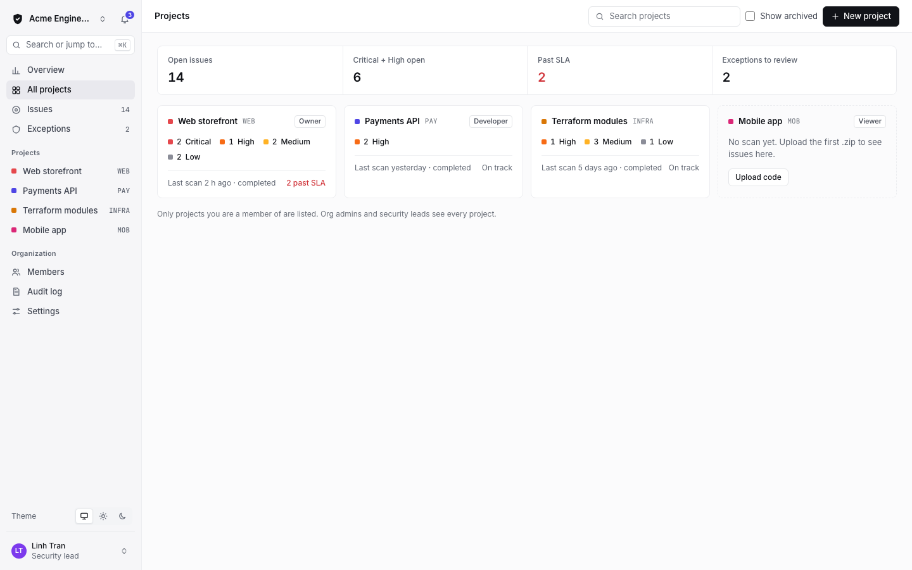

### 2. Upload & scans
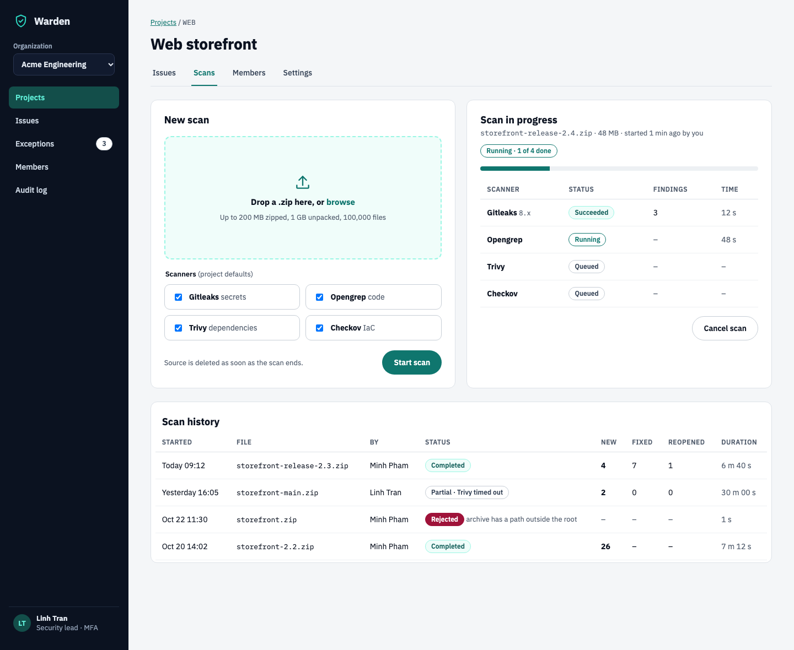

### 3. Issue list
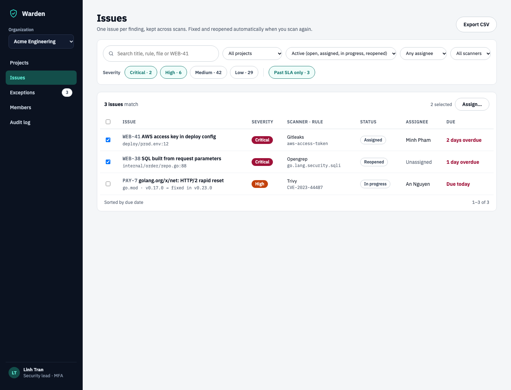

### 4. Issue detail
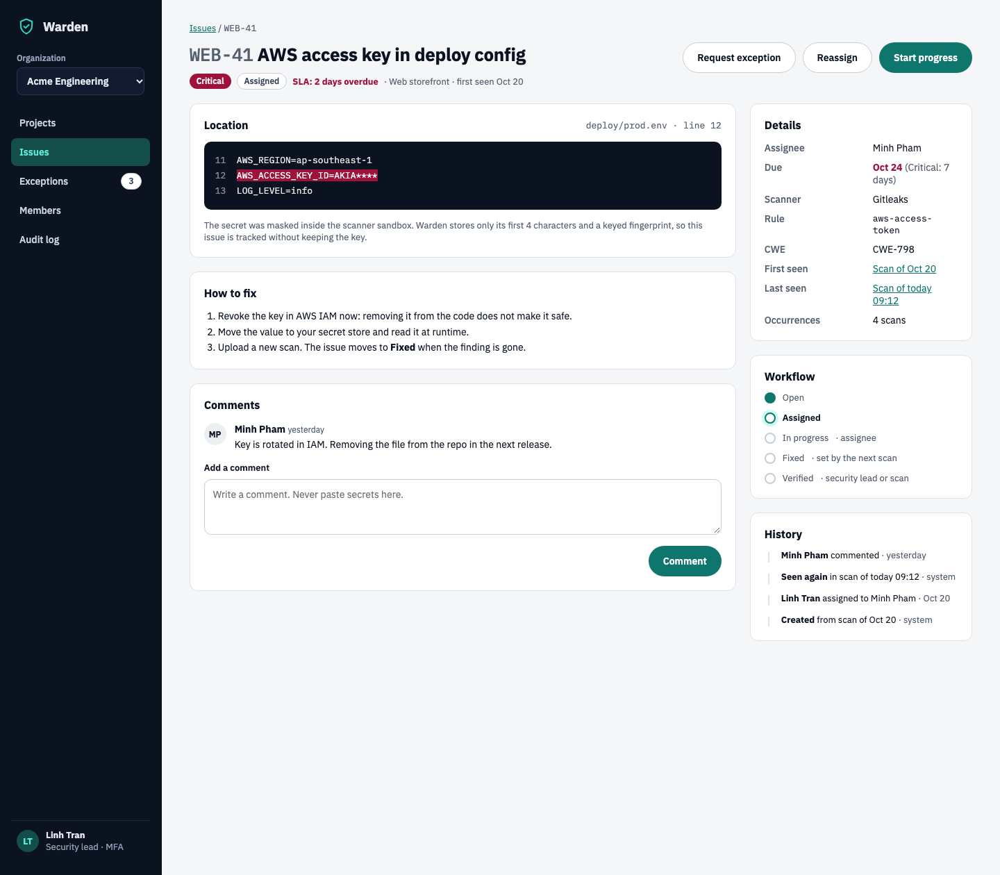

### 5. Exceptions
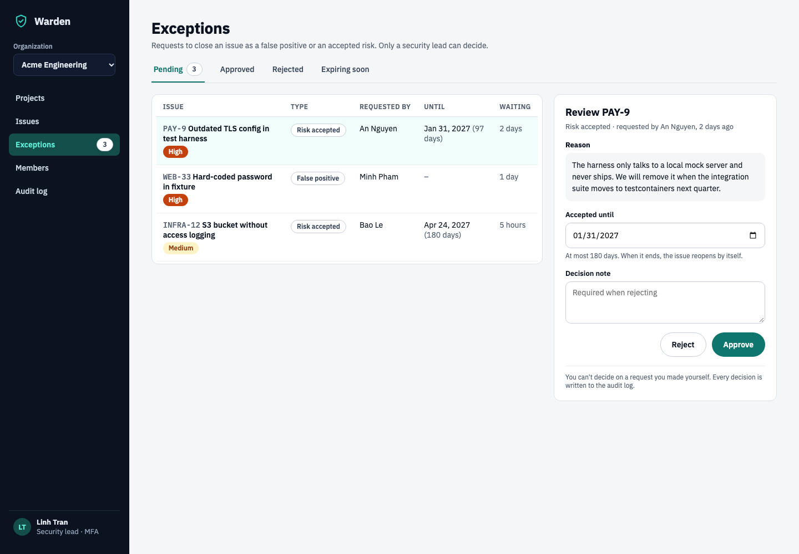

### 6. Members & roles
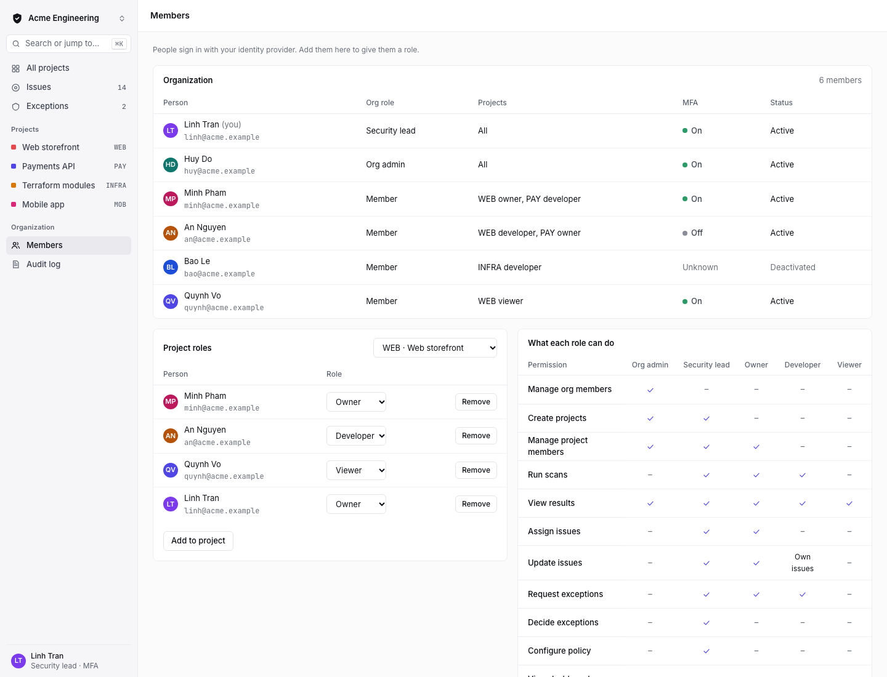

### 7. Audit log
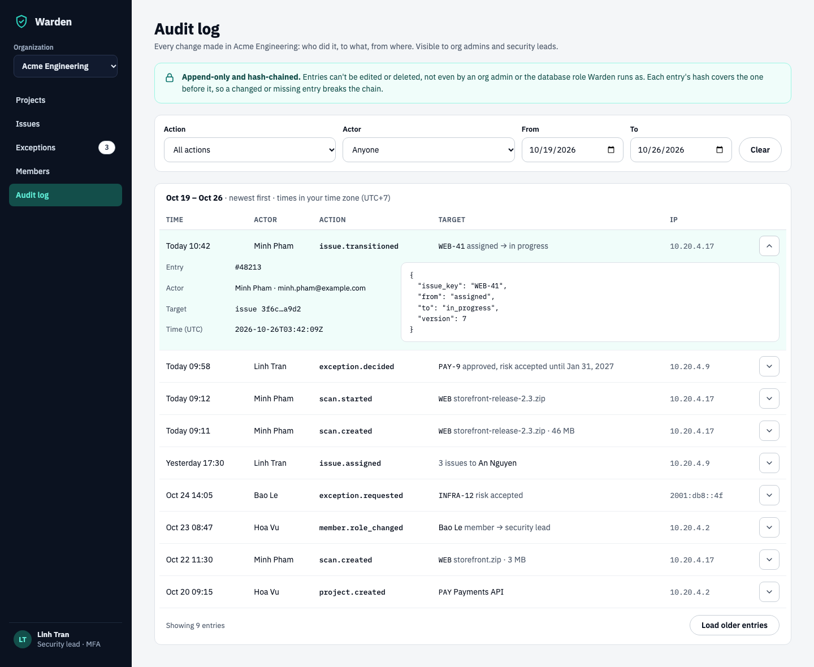

### 8. Upload flow states
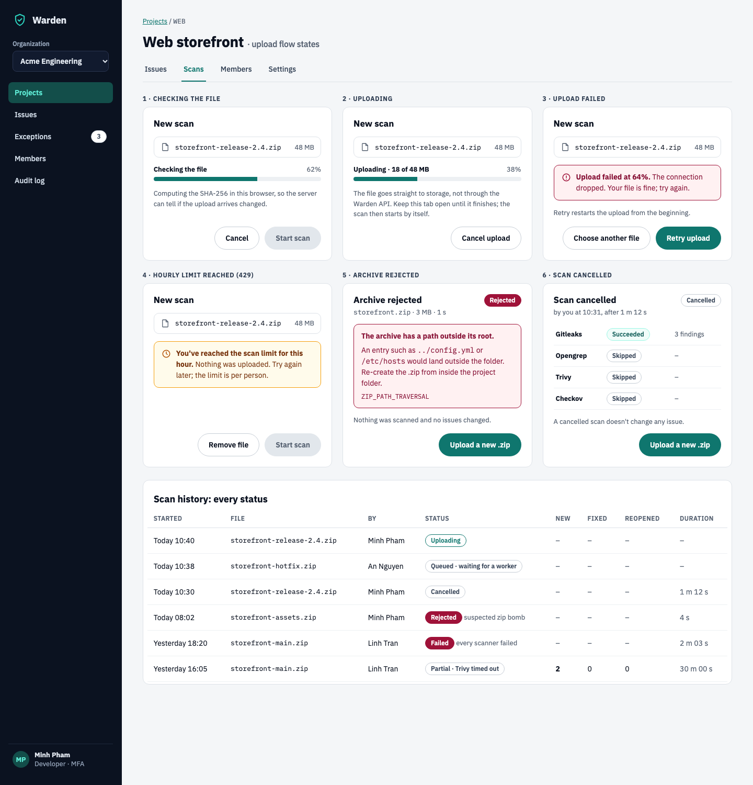

### 9. Dialogs
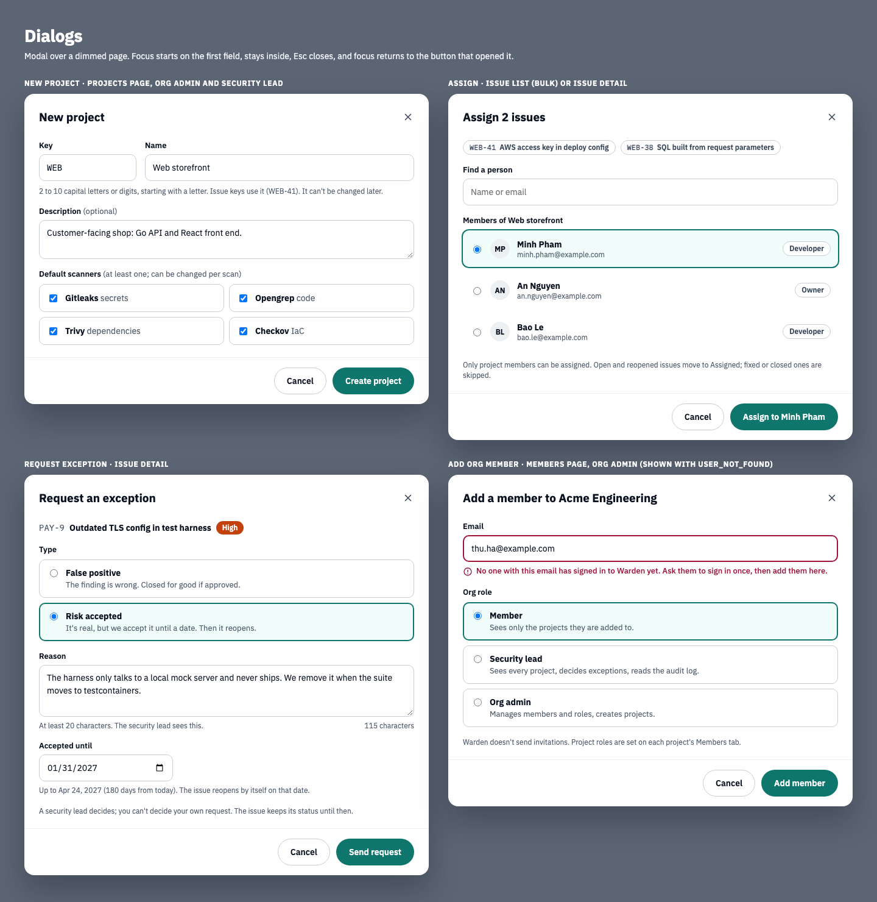

### 10. Loading and empty states
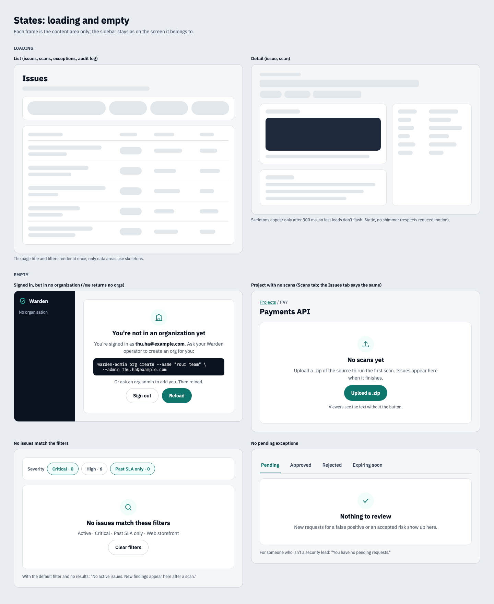

### 11. Errors and messages
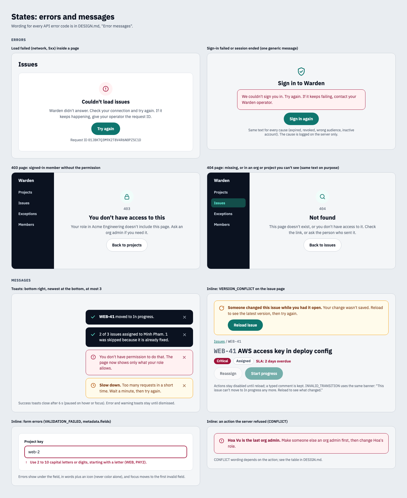

### 12. Phone (390 px)
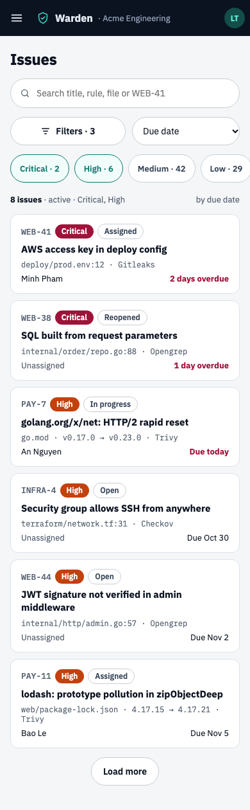 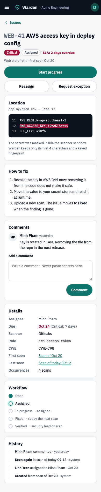 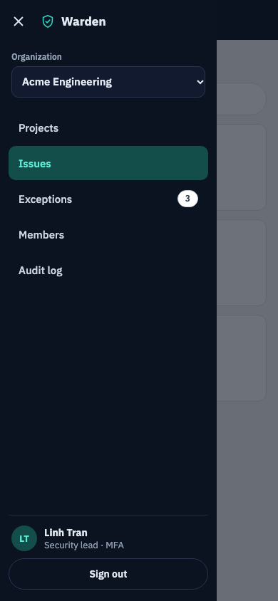

## Audit log

- Data: `GET /orgs/{org_id}/audit-log`, newest first, paginated with "Load older entries"
  (cursor), not page numbers. Only org admins and security leads (`view_audit_log`).
- Filters: action (the action names, shown as they are, in mono), actor (org members) and a
  from/to date range (see Open decisions). "Clear" resets all three.
- Row: time (relative for today and yesterday, then `Oct 24 14:05`, in the viewer's time zone,
  stated above the table), actor (`null` = "System"), action, target, IP. The target column is
  a one-line summary built from `target_type`, `target_id` and `data` (an issue key and the
  status change, a project key and file name, a member and the role change). If the UI can't
  summarise an action, it shows `target_type` and `target_id`.
- The expand button (`aria-expanded`, `aria-controls`) shows the entry number, the actor's
  email, the full target ID, the UTC timestamp and `data` as pretty-printed JSON. `data` is
  shown as text, never as HTML.
- The note above the filters says what the log guarantees: entries can't be changed or deleted,
  and each hash covers the previous entry. It doesn't claim the chain was verified; the UI
  can't check it (see Open decisions).

## States

### Loading
- Show a skeleton only if data takes more than 300 ms. The page title, tabs and filters render
  at once; only data areas get skeletons. Skeletons are static grey bars (`#E2E7EC`), no
  shimmer.
- The loading region has `aria-busy="true"` and a visually hidden `role="status"` text
  ("Loading issues…").
- Lists: 5 skeleton rows in the real column layout. Detail pages: header bars, then the real
  card layout with bars inside.

### Empty
| Where | Title | Text and action |
|---|---|---|
| `/me` returns no orgs | You're not in an organization yet | Shows the signed-in email and the operator command `warden-admin org create --name "…" --admin <your email>`; "or ask an org admin to add you". Buttons: Sign out, Reload. No navigation besides the logo. |
| Project with no scans | No scans yet | "Upload a .zip of the source to run the first scan. Issues appear here when it finishes." Button "Upload a .zip" only for roles with `run_scan`. Same block on the project's Issues tab. |
| Issue list, filters give nothing | No issues match these filters | Repeats the active filters in words; button "Clear filters". With the default filter: "No active issues. New findings appear here after a scan." |
| Exceptions, pending tab | Nothing to review | "New requests for a false positive or an accepted risk show up here." Non-security-leads: "You have no pending requests." |

### Errors
- **Load failed** (network or 5xx): in place of the data, "Couldn't load issues", a "Try again"
  button, and the `meta.request_id` (when there is one) in small mono text so people can quote
  it to the operator.
- **403 page:** "You don't have access to this", "Your role in <org> doesn't include this page.
  Ask an org admin if you need it." Button back to Projects.
- **404 page:** "Not found", "This page doesn't exist, or you don't have access to it." The API
  answers 404 for objects in orgs or projects the caller can't see, so the UI must not suggest
  which case it is.
- **Sign-in failed / session ended:** one message for every cause (see Security rules).

### Messages
- **Toasts** confirm a finished action or report an action that failed with no better place
  to show it. Bottom right on desktop, full width above the bottom edge on phones, newest at
  the bottom, at most 3. Success: dark (`#0B1220`) with a teal check, `role="status"`, closes
  after 6 s, paused while hovered or focused. Error (`#FFF1F2` / `#881337`) and warning
  (`#FFFBEB` / `#78350F`): `role="alert"`, stay until dismissed. The dismiss button is 44 px.
- **Inline banners** sit where the problem is: at the top of the issue page for
  `VERSION_CONFLICT` and `INVALID_TRANSITION` (actions disabled until "Reload issue"; a comment
  being typed is kept), at the top of a dialog for `CONFLICT`.
- **Field errors** go under the field: text plus an icon, `aria-invalid` and
  `aria-describedby`, a 2 px Critical-colored border, and focus moves to the first invalid
  field. Map `error.metadata.fields` to fields by name; anything left over goes in a banner.

## Error messages

Show the plain words; for scan errors also show the code in small mono text under them, so
people can search for it or quote it. Unknown codes fall back to the last row of each table.

### Scan `error_code`

A scan with status `failed` and a `ZIP_*` or `CHECKSUM_MISMATCH` code is shown as
**Rejected** (the archive was refused before any scanner ran); any other failed scan is
**Failed**. There is no `rejected` status in the API. History rows use the short text; the scan
card uses the full text.

| Code | Short (history) | Full message |
|---|---|---|
| `ZIP_PATH_TRAVERSAL` | path outside the root | The archive has a path outside its root. An entry such as `../config.yml` or `/etc/hosts` would land outside the folder. Re-create the .zip from inside the project folder. |
| `ZIP_BOMB` | suspected zip bomb | The archive unpacks to more than 1 GB, or a file in it is compressed more than 100 to 1. Remove large generated or binary files and try again. |
| `ZIP_TOO_LARGE` | archive over 200 MB | The archive is larger than 200 MB. Leave out dependencies and build output (`node_modules`, `vendor`, `dist`). |
| `ZIP_TOO_MANY_FILES` | over 100,000 files | The archive has more than 100,000 files. Leave out dependencies and build output. |
| `ZIP_ENCRYPTED` | password-protected | The archive is password-protected. Upload a .zip without a password. |
| `ZIP_INVALID` | not a readable .zip | This isn't a readable .zip file. Create the archive again with a standard zip tool. |
| `ZIP_EMPTY` | no source files | No files were left to scan. Warden skips `node_modules`, `vendor`, `dist`, `build`, `.git` and `.venv`. |
| `CHECKSUM_MISMATCH` | file changed in upload | The stored file doesn't match the one you picked, so it was not scanned. Upload it again. |
| `ALL_SCANNERS_FAILED` | every scanner failed | Every scanner failed, so there are no results. Each scanner's error is listed below. If it happens again, tell your operator. |
| `TIMEOUT` | took over 30 min | The scan took longer than the 30-minute limit and was stopped. |
| anything else | failed | The scan failed (`<code>`). Tell your operator; the worker log has the details. |

The numbers are the server defaults (`WARDEN_SCAN__UPLOAD_MAX_MB`, `__UNZIP_MAX_MB`,
`__UNZIP_MAX_FILES`, `__TIMEOUT`); see Open decisions. A *partial* scan says which scanner
failed or timed out: "Partial · Trivy timed out".

Status labels: `pending_upload` Uploading, `queued` Queued, `running` Running · *n* of *m* done,
`completed` Completed, `partial` Partial, `failed` Rejected or Failed, `cancelled` Cancelled.

### API `error.code`

| Code | Where it shows | Message |
|---|---|---|
| `UNAUTHORIZED` (401) | Whole app | Try one silent token refresh and repeat the request. If that fails, go to sign-in with the generic "We couldn't sign you in. Try again." |
| `FORBIDDEN` (403) | Page: 403 page. Action: error toast | "You don't have permission to do that." Then refetch, so the page shows only what the role allows. |
| `NOT_FOUND` (404) | Page: 404 page. Action: error toast | "This no longer exists, or you no longer have access to it." |
| `VALIDATION_FAILED` (422) | Under each field in `metadata.fields` | The server's per-field message; the UI checks the same rules first (key pattern, reason ≥ 20 characters, date ≤ 180 days). |
| `CONFLICT` (409) | Banner in the dialog or toast | Depends on the action: "A project with key WEB already exists." / "Thu Ha is already a member." / "<name> is the last org admin. Make someone else an org admin first." / "This scan already finished." / "This issue already has a pending exception request." |
| `VERSION_CONFLICT` (409) | Banner on the issue page | "Someone changed this issue while you had it open. Your change wasn't saved. Reload to see the latest version, then try again." Never retried automatically. |
| `INVALID_TRANSITION` (422) | Banner on the issue page | "This issue can't move to <status> any more. Reload to see what changed." |
| `USER_NOT_FOUND` (404) | Under the email field, add-member dialog | "No one with this email has signed in to Warden yet. Ask them to sign in once, then add them here." |
| `UPLOAD_MISMATCH` (422) | Upload card, same layout as "upload failed" | "The upload didn't arrive complete. Upload the file again." |
| `RATE_LIMITED` (429) | Upload card (scan create); toast elsewhere | Scans: "You've reached the scan limit for this hour. Nothing was uploaded. Try again later." Elsewhere: "Too many requests in a short time. Wait a minute, then try again." If the response has `Retry-After`, say when. |
| network error, 5xx | Load: in place of the data. Action: error toast | "Warden didn't answer. Check your connection and try again." plus the request ID if there is one. |

## Upload flow

What the New scan card shows at each step (wireframe 8):

1. **Choose a file.** The browser checks the extension (`.zip`), the name (≤ 255 characters, no
   `/` or `\`) and the size (≤ 200 MB) before anything is sent.
2. **Checking the file:** the SHA-256 is computed in the browser, with a progress bar. Use
   an incremental hash in a Web Worker (`crypto.subtle.digest` has no progress and needs the
   whole file in memory). "Cancel" stops it; nothing has been sent yet.
3. `POST …/scans` with name, size, hash and the chosen scanners. A 429 shows the hourly-limit
   banner here and nothing is uploaded.
4. **Uploading:** PUT the file to `upload.url` with exactly `upload.headers`, using
   `XMLHttpRequest` so `upload.onprogress` can drive "18 of 48 MB · 38%" (`fetch` has no
   upload progress). "Cancel upload" aborts the request and calls `…/cancel` on the scan.
5. **Upload failed** (network error or a non-2xx answer from storage): "Upload failed at 64%",
   with "Retry upload" and "Choose another file". Retry PUTs again while the link is valid
   (`expires_at`, 15 minutes); after that it cancels the old scan and starts again from step 3,
   without hashing again. The user doesn't see the difference.
6. `POST …/start`. `UPLOAD_MISMATCH` shows the upload-failed card with its own message. On
   success the right-hand card becomes "Scan in progress" (wireframe 2).
7. **Finished:** Completed, Partial, Failed or Rejected. A rejected archive shows the full
   message from the table above, the code, "Nothing was scanned and no issues changed" and
   "Upload a new .zip". A cancelled scan shows who cancelled it, when, each scanner's state, and
   "A cancelled scan doesn't change any issue."

Keep the tab open during steps 2–5; if the user tries to leave, the browser's
"leave page?" prompt asks first (`beforeunload`). Poll `GET …/scans/{id}` every 3 s while a
scan is queued or running, and stop when it finishes.

## Dialogs

All dialogs (wireframe 9): modal, `role="dialog"`, `aria-modal="true"`, `aria-labelledby` on the
title; focus starts on the first field, stays in the dialog, Esc and the 44 px close button
cancel, and focus returns to the button that opened it. The primary button is on the right
and says what it does ("Create project", not "OK"). While the request runs, the primary button
is disabled and shows a spinner; errors appear in the dialog, which stays open.

- **New project** (Projects page; org admin, security lead): key (mono, uppercased while
  typing, `^[A-Z][A-Z0-9]{1,9}$`, "can't be changed later"), name, optional description, default
  scanners (all four checked, at least one). 409: "A project with key WEB already exists."
- **Assign** (issue list bulk action; issue detail "Reassign"; security lead, project owner):
  the selected issues as chips, a search box, and a radio list of the project's members
  (`GET …/projects/{id}/members`) with their project role. The button names the person
  ("Assign to Minh Pham"). `POST …/issues/assign` returns `updated`; if it is less than the
  number selected, the toast says how many were skipped and why ("1 was skipped because it is
  already fixed").
- **Request exception** (issue detail; when `can_request_exception`): the issue key, title and
  severity; type as two radio cards (False positive / Risk accepted, each with one line on what
  it means); reason (live character count, at least 20); "Accepted until" only for Risk accepted:
  a date input with `min` tomorrow and `max` today + 180 days, and the help text names the last
  allowed date. The issue keeps its status until a security lead decides; afterwards the issue
  page shows "Exception requested" and hides the button (`pending_exception_id`).
- **Add org member** (Members page; org admin): email, and the org role as radio cards with one
  line each on what the role can do (Member, Security lead, Org admin). `USER_NOT_FOUND` shows
  under the email field. Warden sends no invitations.

## Phone layout

Below 800 px (wireframes 12–14):

- The sidebar becomes a 56 px dark top bar: a 44 px menu button (`aria-expanded`,
  `aria-controls`), the logo, the org name (truncated) and the user's initials. The menu opens
  as a 304 px drawer from the left over a dimmed page, with the org switcher, the navigation,
  the user and "Sign out". Esc, the close button or a tap outside closes it.
- Tables become stacked rows. An issue row is one link (the whole row): key, severity and status;
  title; file and scanner; assignee and due date. Other tables (scans, exceptions, members, audit
  log) follow the same pattern with their first column as the title.
- Issue list: search, then "Filters · *n*" (opens the other filters in a full-screen sheet) and
  the sort select side by side, then the severity chips in one row that scrolls sideways. No
  checkboxes and no bulk assign on phones.
- Issue detail: a 44 px "‹ Issues" back link; the actions under the title, primary full width
  and the other two side by side; then the cards in one column in the desktop order (location,
  how to fix, comments, details, workflow, history). The code snippet scrolls sideways inside
  its block (`tabindex="0"` so keyboard users can scroll it).
- Page padding is 16 px; every control stays at least 44 px tall.

## Security rules for the UI

- Never show a raw secret. Secret findings show the masked value only (`AKIA****`, from
  `redact.Mask`) and say that Warden does not keep the secret.
- The comment box warns people not to paste secrets.
- Show authentication errors as one generic message; the reason goes to the server logs.
- Severity is never shown by color alone: every badge carries its label.
- Uploads go straight to object storage. The UI never reads the archive's contents (it
  only hashes the bytes).
- Text that came from scanned code or other users (titles, snippets, comments, audit `data`,
  server error messages) is rendered as text, never as HTML.
- A 404 never says whether the object exists in an org or project the user can't see.

## Visual system

Warden has its own look, not tied to any company brand.

| Token | Value | Use |
|---|---|---|
| Ink | `#0B1220` | Text; sidebar background; code block background |
| Muted | `#556070` | Secondary text (≥ 4.5:1 on white) |
| Ground | `#F4F6F8` | Page background |
| Surface | `#FFFFFF` | Cards, tables |
| Line | `#DDE2E8` / `#EDF0F3` | Borders / row dividers |
| Accent | `#0F766E` (hover `#115E59`) | Primary buttons, links, progress, selected state |
| Accent tint | `#F0FDFA` / `#99F6E4` | Selected chips, drop zone, success pills |
| Sidebar active | `#134E4A` on `#5EEAD4` text | Current navigation item |

Severity, by the usual security-tool convention, also differing in lightness:

| Severity | Badge |
|---|---|
| Critical | `#9F1239`, white text |
| High | `#C2410C`, white text |
| Medium | `#FEF3C7`, text `#92400E` |
| Low | `#E2E8F0`, text `#334155` |

"Past SLA" text and the highlighted secret line in a code snippet use the Critical color.

- **Type:** IBM Plex Sans for text; IBM Plex Mono for code, rule IDs, file paths and issue keys
  (`WEB-41`).
- **Shapes:** cards have a 12 px radius and a 1 px border with no shadow; buttons and status
  pills are fully rounded (pills).
- **Sizes:** controls are at least 44 px tall, and dense table controls at least 36 px. Page
  padding is 32 × 40 px and the gap between cards is 16–20 px.
- **Layout:** a 232 px dark sidebar beside fluid content. Below 800 px the sidebar becomes a
  top bar with a menu button and tables become stacked rows (see "Phone layout").
- **Messages:** error banners and toasts `#FFF1F2` with text `#881337` and a `#9F1239` border;
  warnings `#FFFBEB` with text `#78350F` and a `#F59E0B` border; skeleton bars `#E2E7EC`.
- **Accessibility:** use real `<button>`, `<a>`, `<label>` and `<input>` elements;
  `aria-label` on icon-only controls; text contrast of at least 4.5:1.

## Open decisions

In the v0.1 API contract and being built (the UI can rely on them once they land):

- Block a security lead from deciding an exception they requested themselves (403, also
  enforced in the database).
- An "Expiring soon" tab for accepted risks (`?status=expiring`, 14 days).
- Cancel a scan, including a running one.

In the wireframes but not in the API contract:

- Export the issue list as CSV.
- Show users who are deactivated in the identity provider. The API has only Warden's own
  `is_active` flag.
- Audit log date range: the endpoint filters by `action` and `actor_id` only. It needs
  `from`/`to` parameters, or the date filter is dropped.
- Audit log chain check: no endpoint verifies the chain or returns the hashes, so the screen
  only states the guarantee. A "verify" action (or `warden-admin audit verify` for operators)
  would back it up.
- Limits: upload size, unpacked size, file count, scan timeout and the hourly scan limit are
  server settings that no endpoint returns, so the UI shows the defaults (200 MB, 1 GB,
  100,000 files, 30 minutes). An operator who changes them gets wrong text. Proposal: return
  them from `GET /me` or a small `GET /config`.
- `Retry-After` on 429: not specified, so the UI can only say "try again later".
- Abandoned uploads: a scan whose upload never finished (tab closed) stays `pending_upload`
  until something cleans it up. The server should expire them after the 15-minute link.
- Cancelled scans: the design says a cancelled scan changes no issue, and that scanners which
  didn't finish show as *Skipped*. The worker must behave that way.
- Bulk assign across projects: the dialog lists people who are members of every selected
  issue's project. The API doesn't say what happens when the assignee isn't a member of one of
  them; it should skip that issue and count it as skipped.

## Not in v0.1

API tokens and a CI gate, email or Slack notifications, trend dashboards, automatic assignment
rules, per-org SLA and severity overrides, and archiving projects.
